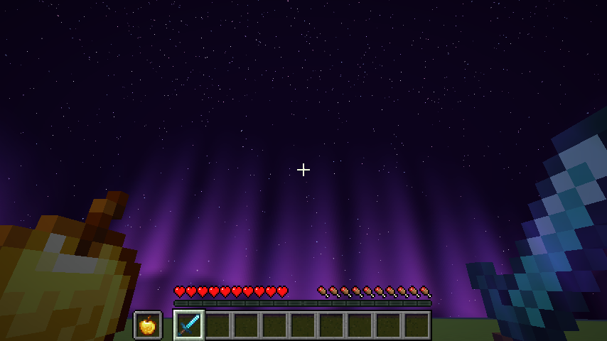
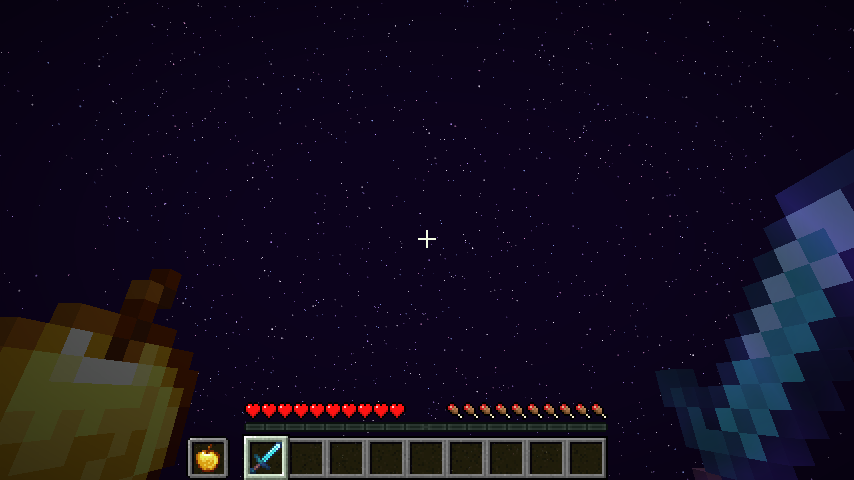

# Crystal Universals Purple

made by ways, discord: waystobe

everything from crystal universals plus a custom sky.

- low fire: fire blocks are only a few pixels high
- no fire on screen: the burning overlay is transparent
- smaller totem particles and smaller potion particles
- every particle except totem, potion, firework and crit is turned off (block break dust and item crumbs are drawn from block and item textures, a pack can not turn them off)
- smaller totem pop on screen (the item that flashes in the middle is 30% size, item frames with a totem are smaller too)
- half full bright: the light level never goes under 65%
- enchantment levels show as 1, 2, 3 instead of I, II, III (potion levels too)
- sky: it is always night. deep purple background, a purple aurora along the horizon, three star layers that twinkle. day, dusk and dawn all look the same.
- the sky is made with the Nuit mod, so install Nuit. it works even with sodium extra's sky, sun, moon and stars turned off.
the enchant glint textures are not part of this pack. they belong to Lioren ('Old Enchant Glint Plus'). to get that glint, put that pack above this one.

version: minecraft 1.21.11 (pack format 75)

